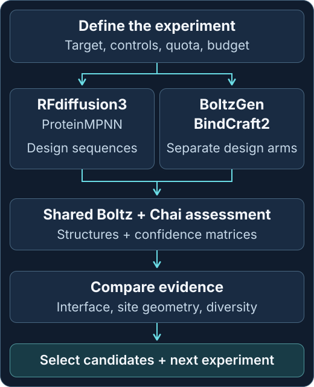

# BioSymphony Structure Factory

Give your AI agent this repository and a structural biology task. Your agent
can use the tool cards to choose methods, configure and call tools, and pass
checked structures, scores, and other files to the next stage. The repository
provides portable agent instructions and the `bsf` CLI.

[](LICENSE)
[](#status)

[Tool menu](#what-your-agent-can-do), [Example tasks](#more-tasks-to-give-your-agent),
[How tool calls work](#how-your-agent-calls-and-chains-tools)

## How To Use This

Point Codex, Claude Code, or another command-capable agent at the
[repository checkout](https://github.com/BioSymphony/structure-factory). Ask it
to read the [Structure Factory skill](skills/biosymphony-structure-factory/SKILL.md)
and give it your scientific question, inputs, desired outputs, and execution
limits.

### Hand A Mission To An Agent

```text
Use the Structure Factory skill in this checkout. Predict the structure of
human ubiquitin from the public PDB 1UBQ sequence, then compare the prediction
with the deposited structure.

Check the Boltz tool card and local adapter. Record the installed version
and alignment source, then prepare and dry-run the call.
Run the prediction if my configured runtime is ready and authorized.
Use the deposited coordinates as the comparison reference.

Return the checked model, confidence summary, and execution receipt. Include
aligned residue coverage, C-alpha RMSD, and any failed or missing outputs.
If execution is blocked, report the missing setup and the next action.
```

<p align="center">
  
</p>

The bundled `boltz-local-v1` adapter calls the installed Boltz executable.
It checks for one parseable structure and a matching confidence JSON per
input and hashes the output bundle. [Boltz adapter guide](docs/binder-lane-round.md#run-tools-through-adapters),
[RCSB PDB 1UBQ](https://www.rcsb.org/structure/1UBQ)

## What Your Agent Can Do

Each tool card describes when to use the method, its inputs and outputs, and
its runtime and license requirements. The [tool card index](tools/README.md)
routes by scientific task. The [software registry](references/software-registry.yaml)
and [tool radar](docs/tool-and-skill-radar.md) provide source and version records.

| Scientific task | Methods to consider | Outputs to pass downstream |
| --- | --- | --- |
| Generate backbones or paired designs | [RFdiffusion3](tools/rfdiffusion3.md), [Genie3](tools/genie3-peptides.md), [BindCraft2](tools/bindcraft2.md), [BoltzGen](tools/boltzgen.md) | Backbones for sequence design or paired sequences and structures for evaluation |
| Design helical or cyclic peptides | [HelixDiff](tools/helixdiff.md), [PepGLAD](tools/pepglad.md), [RFpeptides](tools/rfpeptides.md) | Peptide backbones or sequence-structure pairs for prediction and scoring |
| Design sequences for a backbone | [ProteinMPNN](tools/proteinmpnn.md), [MoMPNN](tools/mompnn.md), [ProtonPottsMPNN](tools/protonpottsmpnn.md) | Sequence sets for structure prediction or property comparisons |
| Plan designs for flexible targets or multiple states | [GuideFlip](tools/guideflip.md), [SwitchCraft](tools/switchcraft.md) | Candidate sequences and models for evaluation across target states |
| Predict structures or complexes | [Boltz](tools/boltz.md), [Chai](tools/chai.md), [ESMFold2](tools/esmfold2.md), [OpenFold3](tools/openfold3.md) | Structure files and model confidence data for scoring or review |
| Sample alternative conformations | [BioEmu](tools/bioemu.md), [SimpleFold](tools/simplefold.md) | Monomer ensembles for comparing flexibility and conformations |
| Score models and qualify filters | [Cofold scoring stack](tools/cofold-scoring-stack.md), [binder filtering](tools/binder-filtering.md), [refinement stack](tools/refinement-stack.md) | Per-model scores, filter decisions, and failure rows for candidate review |
| Prioritize compounds and review poses | [MolPAL](tools/molpal.md), [PoseBusters](tools/posebusters.md), [PLACER](tools/placer.md) | Compounds for the next screening round, pose checks, and local conformational ensembles |
| Compare and render structures | [ChimeraX](tools/chimerax-peptide-viz.md), [MolViewSpec](tools/molviewspec.md) | Structure overlays, figures, and reusable molecular views |

## More Tasks To Give Your Agent

- "Compare Boltz and Chai on the same public protein complexes. Use the same
  reference structures and reporting criteria. Return the models, confidence
  fields, and failed inputs." [Model comparison guide](docs/agent-recipes.md#recipe-model-comparison-or-structure-mapping)
- "Compare published binder-design workflows for the PD-L1 interface in PDB 4ZQK.
  Keep target, controls, predictor panel, and ranking criteria fixed. Return
  a validated run plan and the tool bindings each arm needs."
  [PD-L1 fast path](recipes/pd-l1-binder-design-fast-path.md), [Binder comparison contract](docs/binder-comparison-contract.md)
- "Build a state atlas from public active and inactive GPCR structures.
  Align comparable chains, label the regions that move, and return an overlay
  plus a table of differences." [State atlas guide](docs/use-cases.md#gpcr-or-multimer-state-atlas)
- "Use this public PDB/EMDB pair to plan structure mapping. Return accession
  provenance, map/model checks, and a figure outline."
  [Structure mapping guide](docs/use-cases.md#public-pdbemdb-structure-mapping)
- "Use existing scores for a public compound library to plan the next MolPAL
  screening batch. Include the selection rule and PoseBusters checks for
  the available poses." [MolPAL](tools/molpal.md), [PoseBusters](tools/posebusters.md)

For more requests, see [agent use cases](docs/use-cases.md) and the guides to
[pH comparisons](docs/binder-ph-comparison.md),
[GuideFlip inputs](docs/guideflip-input-review.md), and
[glycan context](docs/glycan-context-review.md).

## How Your Agent Calls And Chains Tools

1. **Find the execution route.** `bsf binder-lane adapters --workspace .` lists
   command bindings and their implementation status. The bundled registry has
   command bindings for local Boltz, supplied-backbone input, the status-preserving
   filter, and the diversity filter. Each command needs its executable in the
   selected runtime. The registry marks Chai and both ESMFold2 variants as
   `adapter_required`. Supply an adapter to run them through `bsf binder-lane`.
2. **Check or run one tool.** In a dry run, `bsf binder-lane adapter` checks typed
   bindings and looks up the executable. An authorized run calls the program,
   validates its outputs, and records artifact counts and hashes in a receipt.
3. **Connect tools.** `bsf binder-lane prepare-execution` binds a verified plan to
   adapter inputs. `bsf binder-lane execute` runs the prepared chain of local
   commands and checks declared file or directory handoffs before starting
   dependent stages. For example, an interface scorer can use a cofold model
   and its full predicted aligned error (PAE) matrix when the predictor saves
   that matrix.

[Adapter registry](references/binder-execution-adapters.json),
[Controller guide](docs/binder-lane-round.md#prepare-a-controller-request),
[Confidence files for scoring](docs/confidence-sidecars.md)

A local command can call a scientific tool or a configured API, cloud, container,
or scheduler client. Your agent can invoke a platform skill directly and use
the stage closeout contract to verify its outputs. Before a paid start,
non-public upload, terms acceptance, or large or license-gated download,
obtain explicit human authorization. [Compute routes, including RunPod and HPC](docs/compute-backends.md),
[Remote request and receipt contracts](docs/binder-lane-round.md#run-a-remote-tool-through-a-fixed-contract)

## Binder Toolchain Comparisons

Use the [binder-lane skill](skills/binder-lane-round/SKILL.md) to hold target,
controls, and scoring criteria fixed while you compare selected tools. The
[Claude binder lane](docs/claude-binder-lane.md) supports comparisons that reuse
published tool identities, follow the published workflow with different tools,
or test a specific substitution. The
[PD-L1 planning example](examples/pd-l1-binder-design-public) includes a public
target window, generation and cofold plans, and a candidate ranking schema.
[Published workflow reference](references/published-binder-comparison-workflow.json)

## Inspect Or Run The Repo Yourself

To check a local checkout, use `bsf doctor .` and
`bsf binder-lane adapters --workspace .`.
[CLI reference](docs/cli-reference.md), [Local CLI tour](docs/quickstart-tour.md),
[Agent setup](docs/skill-install.md), [FAQ](docs/faq.md),
[Glossary](docs/glossary.md)

<details>
<summary>Campaign planning, coordination, and release checks</summary>

Use `bsf catalog .` to discover workflows, `bsf scaffold-campaign` to write a
campaign plan, and `bsf validate` to check it. Use `bsf issue-dry-run` to draft
tracker tasks. [Workflow map](docs/workflow-map.md),
[Campaign capabilities](docs/capabilities.md), [Task packs](packs/),
[Symphony and Linear](docs/linear-orchestration.md)

Follow the [public release checklist](PUBLIC_RELEASE.md) before publishing.

</details>

## Status

Pre-alpha. The `bsf` CLI requires Python 3.10+. Scientific execution depends on
the configured tool and route. Computational results need independent
validation. [Result boundaries](NON_CLAIMS.md), [Biosafety](BIOSAFETY.md)
