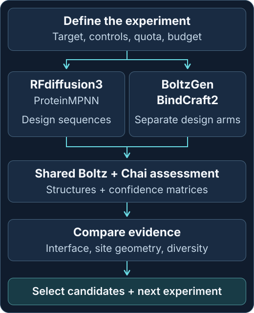

# BioSymphony Structure Factory

Point your AI agent at this repository to plan and run computational structural
biology experiments. Compare protein-design methods, evaluate structures across
predictors, prioritize compound libraries, or investigate conformational states.
Your agent uses the tool guides to select methods, prepare their runtimes, connect
calculations, and interpret the resulting structures and scores.

Structure Factory supplies scientific tool knowledge, portable agent skills,
and the `bsf` CLI for campaign planning, adapter execution, and output checks.
Tool cards connect methods to their inputs, outputs, source code, papers, and
runtime requirements. Campaign contracts keep the target, controls, candidate
coverage, and comparison criteria attached to the work.

[](LICENSE)
[](#status)

[Give your agent a task](#how-to-use-this), [Tool menu](#what-your-agent-can-do),
[Example campaigns](#more-tasks-to-give-your-agent), [Execution](#how-your-agent-calls-and-chains-tools)

## How To Use This

Give Codex, Claude Code, or another command-capable agent the repository URL
and your scientific question. Ask it to read the Structure Factory skill.
Supply your inputs, intended output, and compute limits. The agent can handle
checkout, tool selection, dependency setup, and execution within those limits.
[Repository](https://github.com/BioSymphony/structure-factory),
[Structure Factory skill](https://github.com/BioSymphony/structure-factory/blob/main/skills/biosymphony-structure-factory/SKILL.md)

### Hand A Mission To An Agent

```text
Use BioSymphony Structure Factory to plan and run a comparative binder-design
campaign for the public PD-L1 interface in PDB 4ZQK.

Compare RFdiffusion3, BoltzGen, and BindCraft2. Use ProteinMPNN to complete
backbone-only designs. Preserve native sequence-structure pairs and record
any redesign as a separate arm. Define a common candidate quota, controls,
and assessment policy within my compute budget and runtime limit.

Configure the tools and connect their outputs. Evaluate the agreed candidate
set with Boltz and Chai, save the confidence matrices, and compare interface
scores and target-site geometry against matched controls. Keep each method's
scores, failed candidates, and predictor disagreements in the results.

Return a candidate ranking with diversity groups, structure overlays, and
counts of attempts, unique sequences, fully assessed candidates, and selections.
Use the results to propose the next computational experiment and a validation
plan. Carry out the authorized work through reporting and resource cleanup.
```

This request combines generation, sequence design, prediction, and analysis in
one experiment. The agent configures the selected tools through adapters or
installed skills and uses the comparison contract to keep the methods comparable.
[Binder comparison contract](docs/binder-comparison-contract.md),
[Execution guide](docs/binder-lane-round.md)

## How The Tools Work Together

<p align="center">
  
</p>

The file handoffs determine what the next tool can assess. A sequence designer
needs supported backbone coordinates. A complex predictor needs the target
and candidate sequences. An ipSAE calculation needs the predicted structure,
full predicted aligned error (PAE) matrix, and matching residue mapping.
The agent prepares these inputs and retains their connection to each candidate.
[Prediction handoffs](docs/prediction-handoff-contract.md),
[Confidence files for scoring](docs/confidence-sidecars.md)

Before running, define the hypothesis, comparison arms, controls, sample counts,
primary metric, and stopping rule. Afterward, compare the results with those
criteria. The agent can investigate predictor disagreement, test another target
state, or allocate the next round to a different design arm within the agreed
scope. The round-decision command checks the recorded metric, spend, and round
limit. The agent carries out the permitted next steps.
[Control calibration](docs/binder-controls.md),
[Study decision loop](docs/binder-study-decision-loop.md)

## What Your Agent Can Do

Use the cards to choose tools for each stage. Each card gives method-specific
inputs, output formats, settings, and setup requirements. The registry records
software and model identities for reproducible runs.
[Tool card index](https://github.com/BioSymphony/structure-factory/blob/main/tools/README.md), [Software registry](https://github.com/BioSymphony/structure-factory/blob/main/references/software-registry.yaml),
[Tool radar](docs/tool-and-skill-radar.md)

| Scientific task | Tools and method guides | Outputs to pass downstream |
| --- | --- | --- |
| Generate protein designs | [RFdiffusion3](https://github.com/BioSymphony/structure-factory/blob/main/tools/rfdiffusion3.md), [Genie3](https://github.com/BioSymphony/structure-factory/blob/main/tools/genie3-peptides.md), [BindCraft2](tools/bindcraft2.md), [BoltzGen](https://github.com/BioSymphony/structure-factory/blob/main/tools/boltzgen.md), [Proteina-Complexa](https://github.com/BioSymphony/structure-factory/blob/main/tools/proteina-complexa.md) | Backbones or sequence-structure pairs for independent assessment |
| Design helical or cyclic peptides | [HelixDiff](https://github.com/BioSymphony/structure-factory/blob/main/tools/helixdiff.md), [PepGLAD](https://github.com/BioSymphony/structure-factory/blob/main/tools/pepglad.md), [RFpeptides](https://github.com/BioSymphony/structure-factory/blob/main/tools/rfpeptides.md), [EvoBind](https://github.com/BioSymphony/structure-factory/blob/main/tools/evobind.md) | Peptide candidates for format-aware refolding and interface review |
| Design sequences for a backbone | [ProteinMPNN](https://github.com/BioSymphony/structure-factory/blob/main/tools/proteinmpnn.md), [MoMPNN](https://github.com/BioSymphony/structure-factory/blob/main/tools/mompnn.md), [ProtonPottsMPNN](https://github.com/BioSymphony/structure-factory/blob/main/tools/protonpottsmpnn.md) | Sequences for prediction, property comparisons, or protonation studies |
| Explore flexible targets or switching proteins | [GuideFlip](https://github.com/BioSymphony/structure-factory/blob/main/tools/guideflip.md), [SwitchCraft](https://github.com/BioSymphony/structure-factory/blob/main/tools/switchcraft.md) | Sequence and structure hypotheses for evaluation across target or ligand states |
| Score and evolve antibody sequences | [CoSiNE](https://github.com/BioSymphony/structure-factory/blob/main/tools/cosine.md) | Variant scores and proposed sequences for structural evaluation |
| Predict structures or complexes | [Boltz](https://github.com/BioSymphony/structure-factory/blob/main/tools/boltz.md), [Chai](https://github.com/BioSymphony/structure-factory/blob/main/tools/chai.md), [ESMFold2](https://github.com/BioSymphony/structure-factory/blob/main/tools/esmfold2.md), [OpenFold3](https://github.com/BioSymphony/structure-factory/blob/main/tools/openfold3.md), [Protenix](https://github.com/BioSymphony/structure-factory/blob/main/tools/protenix.md) | Structures and confidence data for comparison, scoring, and review |
| Sample alternative conformations | [BioEmu](https://github.com/BioSymphony/structure-factory/blob/main/tools/bioemu.md), [SimpleFold](https://github.com/BioSymphony/structure-factory/blob/main/tools/simplefold.md) | Monomer ensembles for comparing flexibility and conformations |
| Assess interfaces and qualify filters | [ipSAE and DockQ in the scoring stack](tools/cofold-scoring-stack.md), [binder filtering](https://github.com/BioSymphony/structure-factory/blob/main/tools/binder-filtering.md), [refinement stack](https://github.com/BioSymphony/structure-factory/blob/main/tools/refinement-stack.md) | Interface scores, reference comparisons, filter decisions, and failure rows |
| Prioritize compounds and review poses | [MolPAL](https://github.com/BioSymphony/structure-factory/blob/main/tools/molpal.md), [PoseBusters](https://github.com/BioSymphony/structure-factory/blob/main/tools/posebusters.md), [PLACER](https://github.com/BioSymphony/structure-factory/blob/main/tools/placer.md), [protein-ligand scorers](https://github.com/BioSymphony/structure-factory/blob/main/tools/ligand-affinity.md) | Acquisition batches, pose checks, local ensembles, and endpoint-specific scores |
| Compare and render structures | [ChimeraX](https://github.com/BioSymphony/structure-factory/blob/main/tools/chimerax-peptide-viz.md), [MolViewSpec](https://github.com/BioSymphony/structure-factory/blob/main/tools/molviewspec.md) | Structure overlays, figures, and reusable molecular views |
| Coordinate prediction on a cluster | [BioNeMo Structure Prediction Pipeline](https://github.com/BioSymphony/structure-factory/blob/main/tools/bionemo-structure-prediction-pipeline.md) | MSA, folding, and postprocessing handoffs for a configured Slurm runtime |

## More Tasks To Give Your Agent

- "Benchmark Boltz, Chai, and OpenFold3 on my public complex set. Match input
  preparation, retain every failed input, and compare confidence with reference
  accuracy. Show where the predictors disagree and which cases need further
  investigation." [Model comparison](docs/agent-recipes.md#recipe-model-comparison-or-structure-mapping),
  [Cofold scoring](tools/cofold-scoring-stack.md)
- "Run an active-learning screen on this public compound library. Use MolPAL
  to select batches, my chosen docking or scoring tool to evaluate them, and
  PoseBusters to review available poses. Feed the scores into the next acquisition
  round and return the selected compounds with their scoring history."
  [MolPAL](https://github.com/BioSymphony/structure-factory/blob/main/tools/molpal.md), [PoseBusters](https://github.com/BioSymphony/structure-factory/blob/main/tools/posebusters.md),
  [Protein-ligand scoring](https://github.com/BioSymphony/structure-factory/blob/main/tools/ligand-affinity.md)
- "Compare public active and inactive GPCR structures. Align equivalent regions,
  map conformational changes, and identify contacts that vary by state. Use the
  comparison to plan a state-specific design experiment with explicit controls."
  [State atlas guide](docs/use-cases.md#gpcr-or-multimer-state-atlas)
- "Compare protonation-dependent contributions for these public protein
  complexes. Define paired pH conditions, track protonation and pose assumptions,
  and report sensitivity to the model settings. Identify which conclusions need
  additional measurements." [pH comparisons](https://github.com/BioSymphony/structure-factory/blob/main/docs/binder-ph-comparison.md),
  [ProtonPottsMPNN](https://github.com/BioSymphony/structure-factory/blob/main/tools/protonpottsmpnn.md)
- "Sample conformations of this public protein with BioEmu or SimpleFold. Compare
  the ensemble with deposited structures, summarize variable regions, and build
  molecular views that show the structural differences."
  [BioEmu](https://github.com/BioSymphony/structure-factory/blob/main/tools/bioemu.md), [SimpleFold](https://github.com/BioSymphony/structure-factory/blob/main/tools/simplefold.md),
  [MolViewSpec](https://github.com/BioSymphony/structure-factory/blob/main/tools/molviewspec.md)
- "Review this public PDB/EMDB pair. Check accession provenance and model-to-map
  correspondence, then prepare a validation plan and annotated figures for
  scientific review." [Structure mapping](docs/use-cases.md#public-pdbemdb-structure-mapping)

For a focused first task, ask the agent to predict public ubiquitin with Boltz,
compare the model with PDB 1UBQ, and report aligned residue coverage, C-alpha
RMSD, and confidence. Additional guides cover target preparation and input
context. [Boltz](https://github.com/BioSymphony/structure-factory/blob/main/tools/boltz.md), [Agent use cases](docs/use-cases.md),
[GuideFlip inputs](https://github.com/BioSymphony/structure-factory/blob/main/docs/guideflip-input-review.md), [Glycan context](https://github.com/BioSymphony/structure-factory/blob/main/docs/glycan-context-review.md)

## How Your Agent Calls And Chains Tools

Your agent reads the relevant cards, checks the selected runtime, and prepares
the tool bindings. An adapter declares a command, typed inputs, and expected
outputs. The command can run a scientific program or call an API, container,
cloud service, or scheduler. An installed platform skill gives the agent another
way to operate a tool and return the declared stage outputs.

| Operation | What Structure Factory provides |
| --- | --- |
| Select tools and routes | `bsf catalog .`, `bsf binder-lane menu`, and `bsf binder-lane adapters` expose workflow records and adapter status |
| Prepare an experiment | `bsf scaffold-campaign`, binder plans, and target checks record inputs, comparison arms, dependencies, and resource limits |
| Call one configured tool | `bsf binder-lane adapter` checks bindings and command availability in a dry run, then executes and validates outputs when authorized |
| Chain configured tools | `bsf binder-lane prepare-execution` binds a plan to adapters. `bsf binder-lane execute` runs the prepared commands in dependency order and verifies file handoffs |
| Check results and continue | `closeout` checks artifacts, `coverage-check` accounts for candidate-stage outcomes, and `round-decision` evaluates the next round against the agreed limits |

The bundled command bindings cover local Boltz, supplied-backbone input, status
filtering, and diversity filtering. For a record marked `adapter_required`, have
the agent configure and validate the selected installation or client, then supply
its adapter. Chai and both ESMFold2 variants require that binding for execution
through `bsf binder-lane`. Tool-specific installation and compatibility details
live in their cards. [Adapter registry](references/binder-execution-adapters.json),
[Adapter guide](docs/binder-lane-round.md#run-tools-through-adapters)

Ask your agent to resolve routine setup and input-format issues within your
authorized scope, then continue the experiment. Reuse authorization that covers
the selected tools, data, budget, and runtime. Obtain approval for paid starts,
non-public uploads, terms acceptance, or large or license-gated downloads when
existing authorization does not cover them.
[Execution and authorization](https://github.com/BioSymphony/structure-factory/blob/main/skills/biosymphony-structure-factory/SKILL.md#execute-and-verify)

## Run Across Your Compute And Agent Stack

Choose local programs, hosted APIs, or compute on Modal, RunPod, AWS, FAL,
Lambda Cloud, or SSH/HPC for each stage. Provider profiles describe the resource,
artifact, and cleanup requirements. Your agent configures the matching client
and validates its outputs. [Compute routes](docs/compute-backends.md),
[Remote request and receipt contracts](docs/binder-lane-round.md#run-a-remote-tool-through-a-fixed-contract)

For larger campaigns, task packs define work that separate agents can own,
including dependencies, expected files, and completion checks. Use them with
Symphony and Linear, GitHub Issues, or another queue to coordinate target sets,
method comparisons, and report preparation.
[Task packs](https://github.com/BioSymphony/structure-factory/tree/main/packs), [Agent harness](docs/agentic-biology-harness.md),
[Symphony and Linear](docs/linear-orchestration.md)

## Binder Toolchain Comparisons

The binder-lane skill supports independent comparisons, reuse of published tool
identities, and deliberate tool substitutions. The public PD-L1 planning example
provides a target window, generation and cofold plans, and a candidate ranking
schema. Use it as a starting contract for your selected experiment.
[Binder-lane skill](https://github.com/BioSymphony/structure-factory/blob/main/skills/binder-lane-round/SKILL.md),
[Claude binder lane](https://github.com/BioSymphony/structure-factory/blob/main/docs/claude-binder-lane.md),
[PD-L1 example](examples/pd-l1-binder-design-public),
[Published workflow reference](references/published-binder-comparison-workflow.json)

## Inspect Or Run The Repo Yourself

Use `bsf doctor .` to check a checkout and `bsf binder-lane adapters --workspace .`
to inspect command bindings. Follow the local tour for CLI installation.
[CLI reference](docs/cli-reference.md), [Local CLI tour](docs/quickstart-tour.md),
[Agent setup](docs/skill-install.md), [FAQ](docs/faq.md), [Glossary](docs/glossary.md)

<details>
<summary>Campaign files and contribution checks</summary>

Use `bsf validate` to check a campaign and `bsf issue-dry-run` to draft tracker
tasks. [Workflow map](docs/workflow-map.md), [Campaign capabilities](docs/capabilities.md)

Follow the [public release checklist](https://github.com/BioSymphony/structure-factory/blob/main/PUBLIC_RELEASE.md) before publishing changes.

</details>

## Status

Pre-alpha. The `bsf` CLI requires Python 3.10+. Tool execution uses your configured
installations or services. Generated structures, scores, and rankings are
computational results that require independent validation for biological claims.
[Result boundaries](NON_CLAIMS.md), [Biosafety](https://github.com/BioSymphony/structure-factory/blob/main/BIOSAFETY.md)
